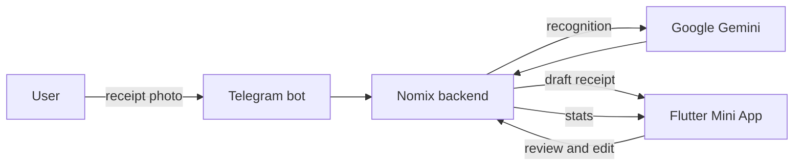
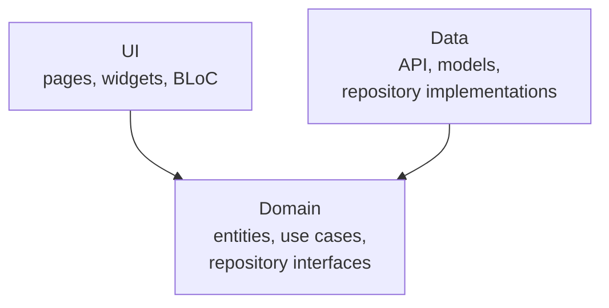

# Nomix 📸 — expense tracking from a photo of a receipt

**English** · [Русский](README.ru.md)

**Nomix** turns a paper receipt into clear spending stats. You send a photo of a receipt in Telegram, an LLM reads the items and prices, and the app shows how much you spent and on what each month.

This is the Flutter client of Nomix. It runs as a **Telegram Mini App** right inside Telegram, and the same codebase builds as a mobile app for iOS and Android.

> Backend: [nomix-backend](https://github.com/Guva99/nomix-backend) — FastAPI, PostgreSQL, a Telegram bot, and receipt recognition with Google Gemini.

---

## How it works



1. The user takes a photo of a receipt and sends it to the Telegram bot.
2. The backend sends the photo to Gemini and normalizes the response into a strict schema: items, quantities, prices, total.
3. The recognized receipt is saved as a draft and opens in the Mini App.
4. The user reviews the items, fixes a name, quantity or price if needed, and saves the receipt.
5. The app builds spending stats by category, product and month.

## Telegram integration

- **Mini App.** The app is built with Flutter Web and opens inside Telegram. `web/index.html` loads the official `telegram-web-app.js`, used through the `telegram_web_app` package.
- **No sign-up.** User data comes from Telegram's `initData` and is sent to the server (`/telegram/login`), which returns a token. No login or password needed.
- **The bot as the entry point.** Receipts go straight into the chat with the bot; viewing and editing the result happens in the Mini App.
- **Native feel.** Haptic feedback through the Telegram Web App API: light, medium or heavy depending on the action.

## Features

- 📥 Review a recognized receipt and edit every item before saving
- 🏠 Home screen with recent receipts and a spending chart
- 📊 Detailed monthly stats by category and product
- 🔐 Sign-in with Telegram
- 🛠 Debug menu with app and network logs (Talker)

## Architecture

The project follows **feature-first Clean Architecture**: every feature is a separate module with its own layers, and dependencies point inward, toward the domain. The UI never calls the API directly, only through use cases and repository interfaces.



```
lib/
├── core/                       # shared by all features
│   ├── internal/               # DI, Dio setup
│   ├── database/               # Hive
│   ├── service/telegram_service/
│   ├── theme/  widgets/  utils/
├── features/
│   ├── app/                    # startup, routing, auth
│   ├── home_page/              # home screen and spending chart
│   ├── approve_receipts_page/  # receipt review and editing
│   ├── detail_statistic_page/  # stats by category
│   └── debug_menu/             # app and network logs
└── main.dart
```

Inside each feature:

```
feature/
├── data/     # data sources (API), models, repository implementation
├── domain/   # entities, repository interface, use cases
└── ui/       # pages, BLoC, widgets
```

## Tech stack

| Area | Tools |
|---|---|
| State management | `flutter_bloc`, `equatable` |
| Navigation | `go_router` |
| Dependency injection | `get_it` + `injectable` |
| Networking | `dio` with interceptors for headers and logging |
| Local storage | `hive`, `shared_preferences` |
| Charts and animation | `fl_chart`, `lottie`, `shimmer`, `flutter_staggered_animations` |
| Logging | `talker`, `talker_dio_logger` |
| Telegram | `telegram_web_app` |

## Getting started

```bash
flutter pub get
dart run build_runner build --delete-conflicting-outputs
flutter run -d chrome
```

## Builds

```bash
# Telegram Mini App
flutter build web --release
firebase deploy --only hosting

# Android
flutter build apk --release      # test build
flutter build appbundle          # Google Play

# iOS
flutter build ipa
```
