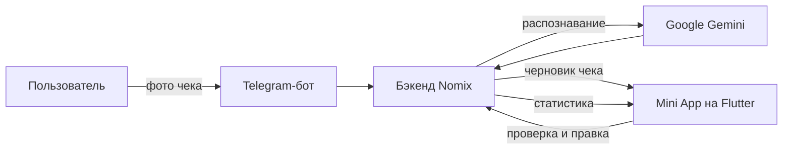
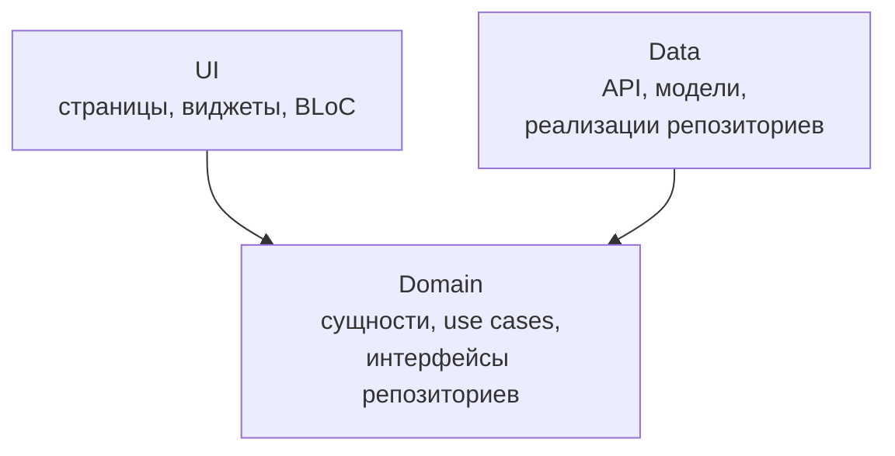

# Nomix 📸 — учёт расходов по фото чека

[English](README.md) · **Русский**

**Nomix** превращает бумажный чек в понятную статистику расходов. Пользователь отправляет фото чека в Telegram, нейросеть распознаёт позиции и цены, а приложение показывает, сколько и на что ушло денег за месяц.

Это Flutter-клиент Nomix. Он работает как **Telegram Mini App** прямо внутри Telegram и собирается как мобильное приложение под iOS и Android из той же кодовой базы.

> Бэкенд: [nomix-backend](https://github.com/Guva99/nomix-backend) — FastAPI, PostgreSQL, Telegram-бот, распознавание чеков через Google Gemini.

---

## Как это работает



1. Пользователь фотографирует чек и отправляет его Telegram-боту.
2. Бэкенд отправляет фото в Gemini и приводит ответ к строгой схеме: позиции, количество, цены, итог.
3. Распознанный чек сохраняется как черновик и открывается в Mini App.
4. Пользователь проверяет позиции, при необходимости правит название, количество или цену и сохраняет чек.
5. Приложение строит статистику расходов по категориям, товарам и месяцам.

## Связка с Telegram

- **Mini App.** Приложение собирается во Flutter Web и открывается внутри Telegram. В `web/index.html` подключён официальный `telegram-web-app.js`, с ним работает пакет `telegram_web_app`.
- **Вход без регистрации.** Данные пользователя берутся из `initData` Telegram и отправляются на сервер (`/telegram/login`), в ответ приходит токен. Логин и пароль не нужны.
- **Бот как точка входа.** Чеки удобно отправлять прямо в чат с ботом, а смотреть и править результат — в Mini App.
- **Нативные ощущения.** Тактильный отклик (haptic feedback) через Telegram Web App API: лёгкий, средний и сильный в зависимости от действия.

## Возможности

- 📥 Проверка распознанного чека и правка каждой позиции перед сохранением
- 🏠 Главный экран с последними чеками и графиком расходов
- 📊 Детальная статистика по категориям и товарам за месяц
- 🔐 Авторизация через Telegram
- 🛠 Отладочное меню: логи приложения и сетевых запросов (Talker)

## Архитектура

Проект построен по **feature-first Clean Architecture**: каждая фича — отдельный модуль со своими слоями, зависимости направлены внутрь, к домену. UI не обращается к API напрямую: только через use cases и интерфейсы репозиториев.



```
lib/
├── core/                       # общее для всех фич
│   ├── internal/               # DI, настройка Dio
│   ├── database/               # Hive
│   ├── service/telegram_service/
│   ├── theme/  widgets/  utils/
├── features/
│   ├── app/                    # запуск, роутинг, авторизация
│   ├── home_page/              # главный экран и график расходов
│   ├── approve_receipts_page/  # проверка и правка чека
│   ├── detail_statistic_page/  # статистика по категориям
│   └── debug_menu/             # логи и сетевые запросы
└── main.dart
```

Каждая фича внутри:

```
feature/
├── data/     # источники данных (API), модели, реализация репозитория
├── domain/   # сущности, интерфейс репозитория, use cases
└── ui/       # страницы, BLoC, виджеты
```

## Стек

| Задача | Решение |
|---|---|
| Состояние | `flutter_bloc`, `equatable` |
| Навигация | `go_router` |
| Внедрение зависимостей | `get_it` + `injectable` |
| Сеть | `dio` с интерсепторами для заголовков и логирования |
| Локальное хранилище | `hive`, `shared_preferences` |
| Графики и анимации | `fl_chart`, `lottie`, `shimmer`, `flutter_staggered_animations` |
| Логирование | `talker`, `talker_dio_logger` |
| Telegram | `telegram_web_app` |

## Запуск

```bash
flutter pub get
dart run build_runner build --delete-conflicting-outputs
flutter run -d chrome
```

## Сборка

```bash
# Telegram Mini App
flutter build web --release
firebase deploy --only hosting

# Android
flutter build apk --release      # тестовая сборка
flutter build appbundle          # для Google Play

# iOS
flutter build ipa
```
